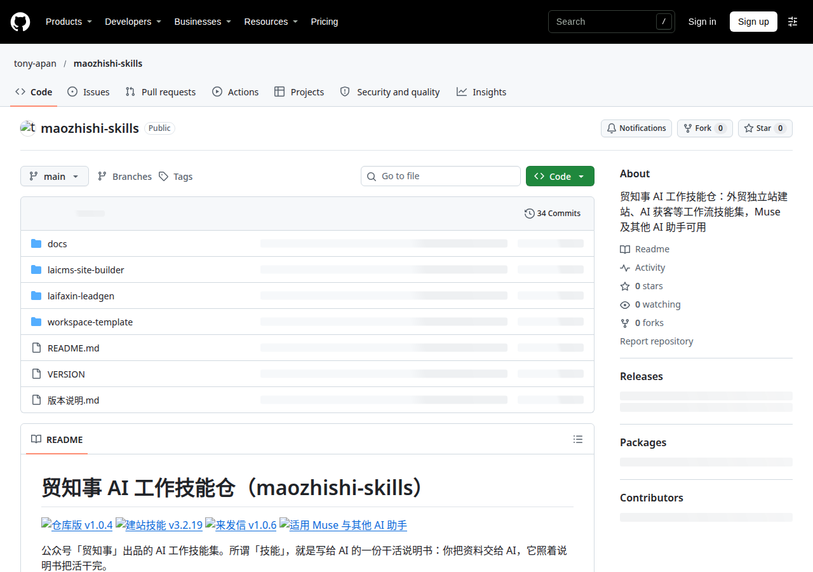
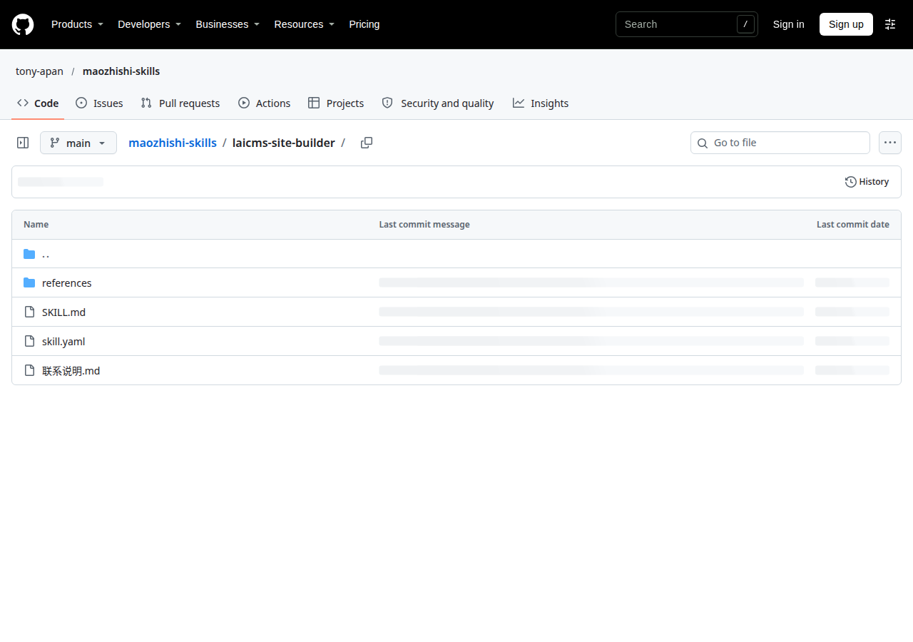
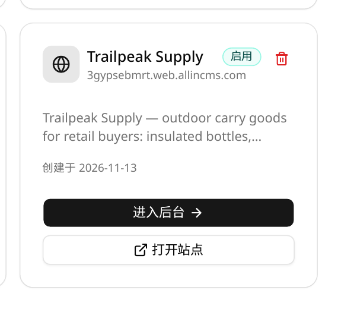
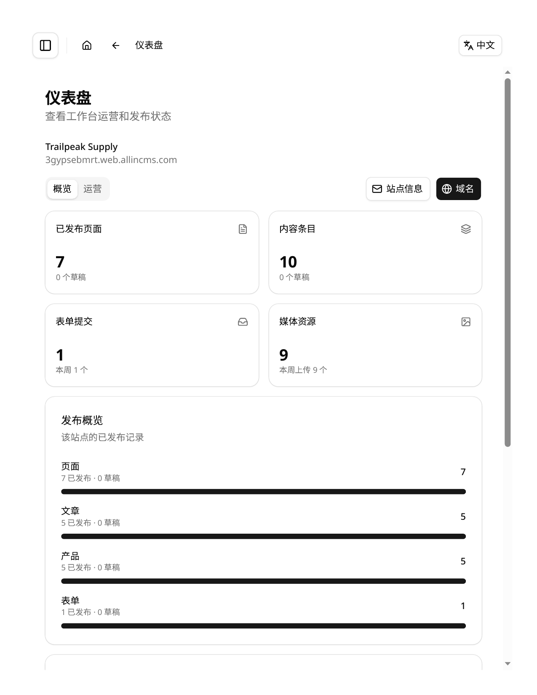
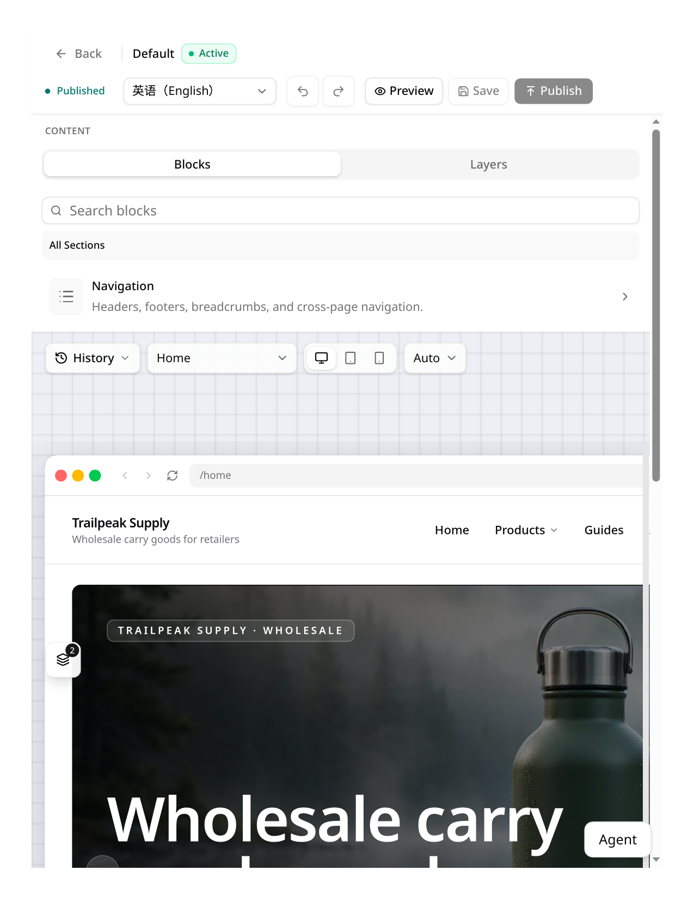
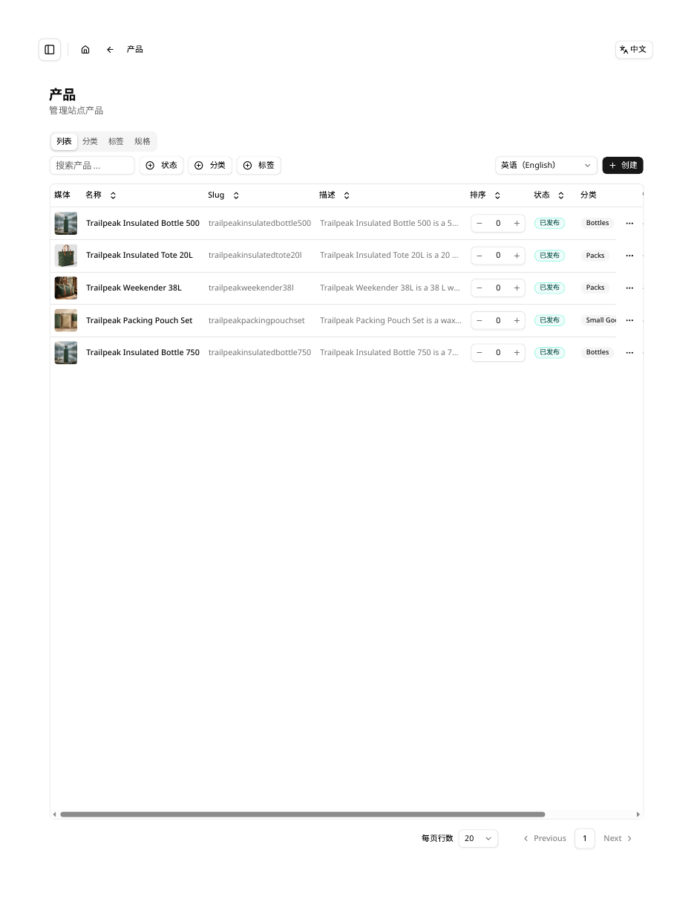
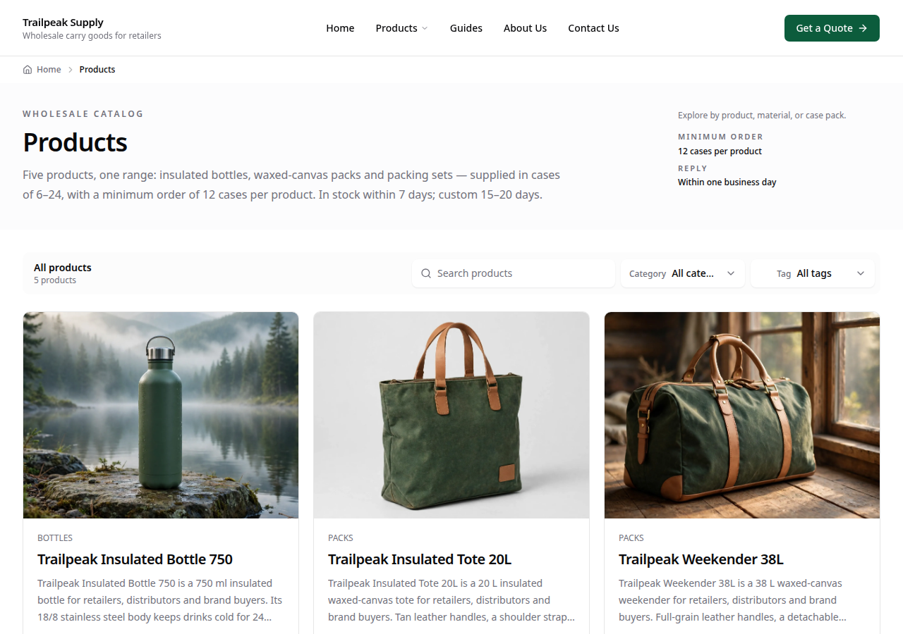
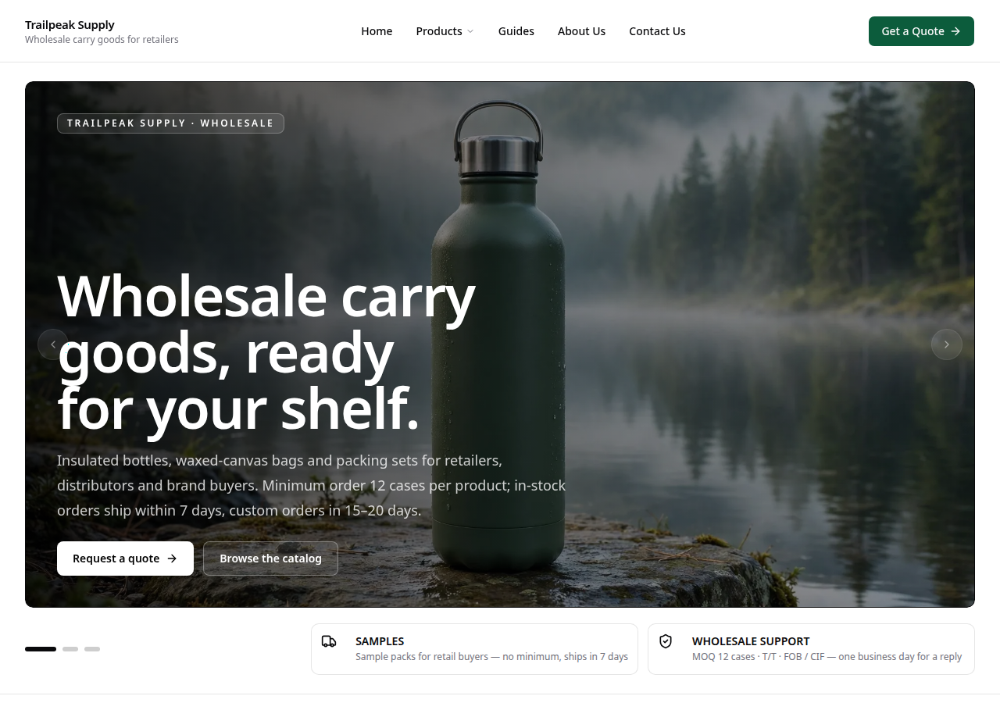
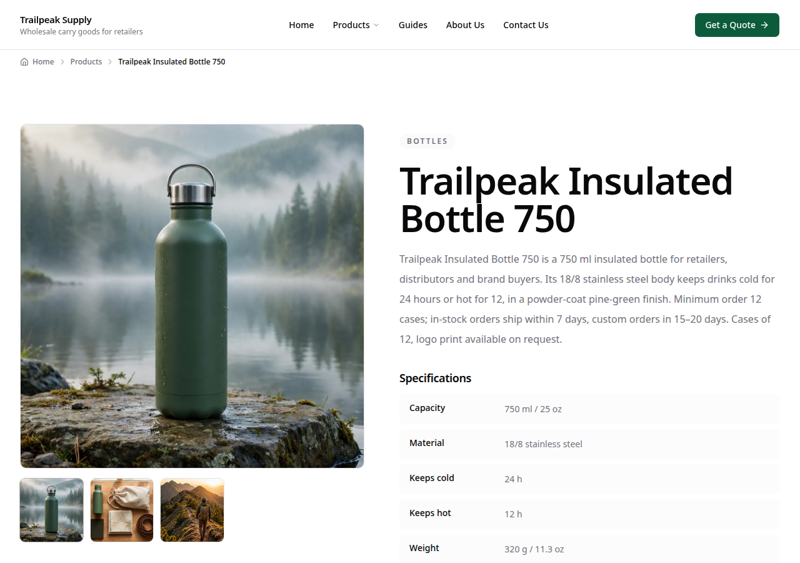
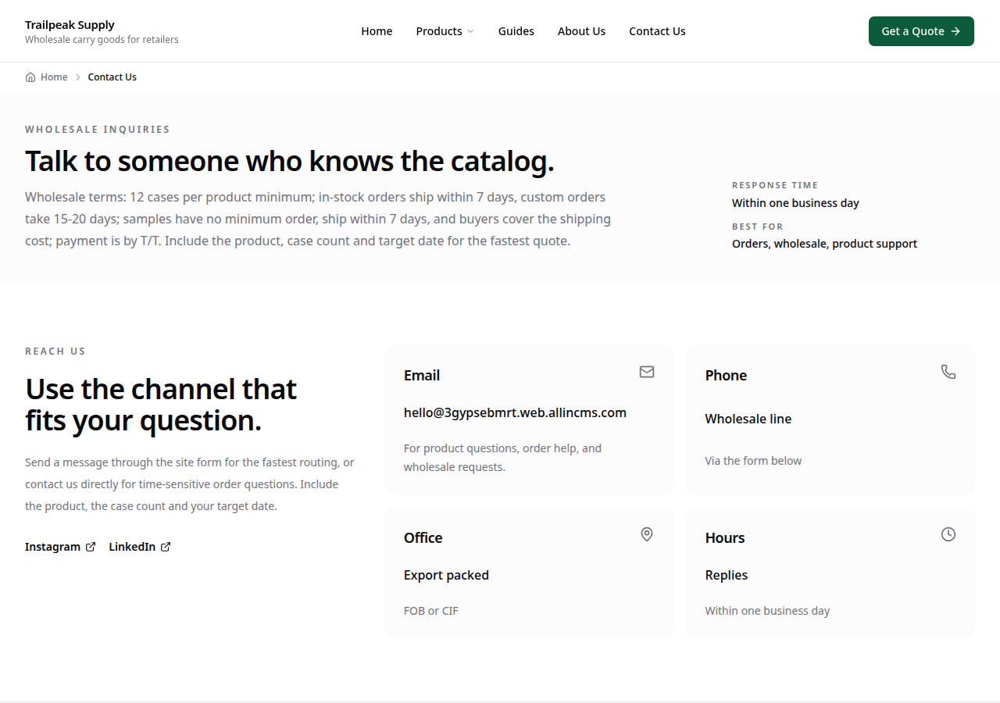

# 新手使用说明：跟着小陈，从零建好一个外贸站

小陈做户外用品出口，手里有保温瓶、帆布包这些产品，想建一个英文网站卖给国外的批发商。他不懂代码，也从来没建过站。

这份说明就带你跟着小陈走一遍全程：要准备什么、跟 AI 说什么、AI 怎么干活、你怎么验收。全程你只做三件事——**回答问题、给资料、看结果点头**，剩下的都交给 AI。

文中的截图，是一个已经建好的户外用品样站（前台和后台都拍了真实的图），你对照着看，心里就有数了。

---

## 开始之前，先准备好三样东西

1. **一个 AI 助手**：比如 Muse，就是平时你跟它说话、让它干活的那一个。没有的话先装一个。
2. **建站技能包**：一个技能包文件，就是这份建站说明书的全套。待会儿你把它下载到手机或电脑上，再在对话里直接发给你的 AI 就行——文件里面是写给 AI 看的，你不用打开看。
3. **一个建站平台账号**：到 AllinCMS 官网 https://www.allincms.com ，按官网的指引注册开通。没有账号时怎么联系官方开通，仓库里另有一份《联系说明》写得很清楚。记住：账号开在你自己名下，建出来的站就是你的。

▲ 技能仓库的首页长这样，能看到仓库名和里面的文件夹。你不用看懂，把链接发给 AI 就行。

---

## 第一步：把技能包发给 AI

1. **先下载技能包**：到技能站 https://skill.maozhishi.com 下载建站技能包，存到你的手机或电脑上。文件名一眼能认，上面标着版本；下载页也会写清这个包里都有什么。
2. **在对话里把文件发给 AI**：打开你的 AI 助手，像发一张照片那样，把刚下载的技能包文件直接发进对话框，再告诉它你想把这个技能装上。
3. **等它先审完再装**：你明确说要装之后，AI 会先按五项清单逐项审这个包——包里有哪些文件、有没有要运行的程序、会不会联网、需要什么权限、会改哪些设置——再如实告诉你查了什么、发现了什么、还有哪些没查清的，以及有没有不能装的问题。审查报告不是安全保证。审完没有阻断问题，就按你的要求装上；没法审完、或有阻断问题，就停下来说明原因，不会因为你同意就跳过审查。
4. **装好后当面确认一次**：装完，AI 会用大白话讲清它干活时会读什么、改什么、要不要往外发东西、会不会在后台自己跑，然后请你选一种用法：全自动，还是每步先问。你点头以后，它会把你的选择写成一份放在你本地的**工作流程文件**——这份文件归你，随时能打开看、能改、想停就删掉它。之后它会告诉你它能帮你做哪几件事，带你从第一件小事开始；需要你提供资料或确认时，一次只问你一件事，并说清要什么、用来做什么。两个补充：① 每日自动开发这类定时任务不在这次确认里，要用时它会单独跟你说明、单独问你；② 要是你的 AI 环境存不了本地文件，它会如实告诉你，那就先不算正式采纳，只按你当次交代的具体事项办。

**备选：只有 Muse 网页版或 App、没有能收文件的 AI 时**，可以走设置页上传，步骤从简：打开设置（Settings）→ Capabilities，把「代码执行与文件创建」打开（这个开关打开后，Muse 能在云端运行代码、创建和保存文件；不想开就不用这条路，走上面的主路） → 左侧 Customize → Skills → 点「+」选 Upload a skill，把下载好的技能包传上去，确认技能开关是开着的，就装好了（页面以你账号里实际显示为准）。装好后同样先让 AI 把装好的文件看一遍、把情况告诉你，再走装后确认（见上一步）才开始用。

▲ 建站说明书放在 laicms-site-builder 这个文件夹里。里面的文件是写给 AI 看的，你不用点开，也不用看懂。

---

## 第二步：AI 问你问题，你照实回答

AI 开工之前会先把几件事问清楚，一次问一件，不会一股脑全甩给你。你知道多少就答多少，拿不准的直接说不知道，它会给你建议。

### 先选一个网站风格（二选一）

1. **外贸 B 端**（默认，推荐）：卖给国外的批发商、经销商、零售店。页面先把起订量、交期、付款方式这些正经条款讲清楚，看着专业、可信。做出口批发的，选这个。
2. **跨境 C 端**：直接卖给国外的普通消费者。页面更活泼，突出好看、好用、生活场景。

小陈卖的是批发，所以他选了外贸 B 端。你拿不准就选外贸 B 端，选错了后面也能改，只是要多花一点时间全站调整。

### 再把你的真实资料给它

AI 会按下面的清单跟你要，有多少给多少：

1. 公司叫什么、哪一年成立的、主要做什么产品；
2. 每个产品的名称、规格（容量、尺寸、重量、材料这些数字）和照片；
3. 产品怎么分组（比如瓶子一类、包一类）；
4. 批发规矩：起订量多少、样品怎么寄、交期多久、能不能印客户的标志、怎么付款、怎么发货；
5. 联系方式：邮箱、电话、公司地址——这些是要放到网站上给买家看的；
6. 有公司标志（Logo）图片就发给它，没有就直说，它会问你打算怎么办。

**一条铁规矩：资料只给真的。** 你没给的数字，AI 不会替你编——它要么把那一处留空，要么回来问你。所以请别嫌它问得多，它问得越细，网站上的内容就越实在，买家看了才敢下单。

---

## 第三步：AI 进后台干活，你等着看样站

资料齐了，AI 就进建站平台的后台开始施工。登录的时候它会请你配合一下（比如把密码存好、确认一次登录），其余操作都不用你管。它大致按这个顺序干：

1. **进你的站**：在后台的站点列表里，找到你的站，点「进入后台」。

▲ 后台的站点列表。你的站会显示在这里，点黑色的「进入后台」按钮就进去。

2. **先看仪表盘**：一眼能看到站里已经有几个页面、几篇文章、几个产品，做到哪一步心里有数。

▲ 站点后台的仪表盘：已发布的页面、文章、产品数量都在这儿。

3. **搭框架、排页面**：在页面编辑器里，一块一块把首页、产品页、关于我们、联系页拼出来，配色、字体、间距都按规矩配好。

▲ 页面编辑器：左边是能用的版块，中间就是正在拼的页面。这些都由 AI 操作，你不用学。

4. **传产品**：把你的产品一个个上架，照片、规格、批发条款都填齐。

▲ 后台的产品列表，AI 传好的产品都排在这儿。

▲ 产品上架完，买家在前台看到的产品列表页长这样：照片、名称、一句话介绍，一目了然。

5. **写文章**：按国外买家真正关心的事来写——比如怎么挑货、起订量怎么回事、交期怎么安排。文章是写给买家看的，也是写给搜索引擎看的。
6. **配好「让买家搜得到你」的设置**：标题和文章里，用上买家平时会搜的词，这样买家在谷歌、或者问 AI 的时候，才容易找到你的站。很多人觉得这件事很难，其实就是把买家会问的话提前写进网站里——这一步 AI 顺手就做了。买家搜得到你，才会有询盘找上门。

样站搭好之后，AI 会把链接发给你。

---

## 第四步：你来验收，不满意就说人话

打开 AI 给你的链接，一页一页看：

▲ 首页首屏：公司名、主打产品、批发条款，打开就要能看到。

▲ 产品详情页：左边是照片，右边是介绍和规格表——容量、材料、保冷保热多久，都要写清楚。

▲ 联系页：买家在这里给你留言问价。这一页的联系方式，必须是你自己的、能收到的。

重点看四件事：

1. 公司名称、联系方式，对不对；
2. 产品的规格数字，对不对；
3. 起订量、交期、付款方式这些规矩，对不对；
4. 整个站看着顺不顺眼、像不像一家正经做批发的公司。

不满意，不用客气，也不用懂术语，**直接说人话就行**，比如：

- 「首页第一张图太暗了，换一张亮一点的。」
- 「起订量写错了，我们是 10 箱起订，不是 12 箱。」

AI 改完你再看。直到你点头确认，它才会把站正式发布出去。

---

## 第五步：上线之后，日常不用你操心

1. **文章会持续更新**：站不是建完就放着，AI 会按约好的节奏接着写文章、传新品，你有新产品随时发给它。
2. **平台有变化，AI 自己跟上**：建站平台改了功能、加了新东西，AI 会自己调整做法，不用你盯着。
3. **询盘从联系页来**：买家在联系页的表单里留言问价，留言会送到开工时约好的地方（比如你的邮箱），你按平时收邮件的习惯处理就行。

---

## 常见问题

**1. 要懂代码吗？**
不用。全程你只做三件事：回答问题、给资料、看结果点头。碰代码的活都是 AI 干。

**2. 要会英文吗？**
不用你写。网站是英文的，AI 来写、来翻；你要看的地方它会用中文跟你说明白。产品数字、公司名字对不对，你认得出就行。

**3. 多久能上线？**
资料齐的话，最快当天就能看到样站。样站改到满意再正式上线，一般一两天。

**4. 要花什么钱？**
两笔：一笔是建站平台的账号费用，以平台官网说的为准；一笔是你用的 AI 助手的费用，按你自己订的套餐。除此之外没有别的收费。

**5. 做出来的站归谁？**
归你。账号是你自己的、站是你自己的、资料也是你自己的。哪天不想用 AI 了，你自己登录后台，也能接着管这个站。

---

## 最后

卡在哪一步，就把这份说明发给你的 AI，让它照着这份说明带你走，它就知道怎么带你了。
