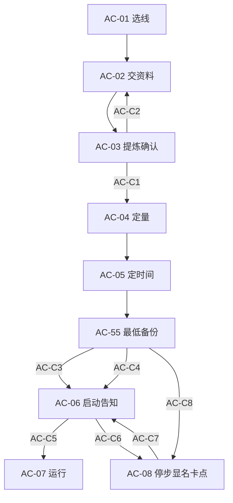

<!-- 包内文件版本标识：laifaxin-leadgen v1.6.4 -->
# 装后引导流程（新用户第一次开工照此走）

本文件管「装好之后怎么一步步带新用户开工」。装机三步（装包、装后确认、接账号）的定义在 SKILL.md §1.1，本文件是装后确认及其后引导的执行顺序与话术定稿；与 SKILL.md 细则冲突时以 SKILL.md 为准。两个技能一起装时，第 1–3 步（自报、确认、选先干哪件）只走一遍，由先被唤起的技能主持，另一个技能随后读工作流程文件衔接，不重复确认。

总原则：一次只让用户做一件事；每一步先用一句话说清这步干嘛，再给选项；选项最多 3 个，推荐项排第一、带 👍 和一句理由，其余项一句说明即可；用户不点就不往下走，沉默不算同意；没轮到的事不预告、不提前问（账号关联、绑邮箱、谷歌关联、运营类引导都等到了对应阶段才提，装机时对每日任务只提醒一句除外）。

## 分层框架（1.6.3 版新增）

装机向导分两层：

- **通用骨架**：第 1–3 步（自报、确认怎么干活、选线）三技能共用，是全仓唯一装机入口。骨架只含共用步，不写任何一条业务线的渠道参数。
- **业务线子流程**：由各技能自声明，选线后按所选业务线进入。子流程步数增减只影响该业务线，不构成骨架变长；新增渠道只加声明，不改骨架。

来发信在第 4 步声明的子流程是「主动开发客户」启动链（4A）；建站、B2B 平台背书不走此链，各走各技能自声明的子流程。

## 第 1 步 · 自报＋提醒（用户不用动手）

装好后先自报，内容从安装结果实读，不预写：装了哪个（或哪两个）技能、各自版本号、装在哪里、校验码与版本号核对结果——只装了一个就只报一个，不提没装的。核对不过就停下报用户，不硬装。自报控制在三行内，细节不展开。末尾带一句提醒（只提醒，不当场建）：「另外先提醒一句：后面可以设每天自动干活的任务，默认不开，到时候我会单独问你。」

## 第 2 步 · 确认怎么干活（用户点 1 次）

用短句讲清四件事：会读什么（产品资料）、会改什么（网站内容）、是否往外发（发开发信）、是否后台运行（每日任务另行问、同意才建）；只装了一个技能时，只讲那个技能的四件事（只装来发信就不提改网站，只装建站就不提发开发信），不让用户为没装的技能点头。并明说：选 1 或 2 就表示同意上面这些，范围按下一步选的那件业务算。参考说法（双装时用）：「开始前先跟你交代清楚。这两个技能会看你的产品资料，会帮你改网站内容，会替你发开发信；你的资料存在你自己的工作区里；每天自动跑的任务，要另外问你同意才建。你选了 1 或 2，就表示同意上面这些，范围按你接下来选的那件业务来。你希望我怎么配合你？」单装时不许照念这句：把「这两个技能」换成所装技能名，四件事按单装口径删改（只装建站：看产品资料、改网站内容、不往外发信；只装来发信：看产品资料、替你发开发信、不改网站），其余句式不变。

选项顺序固定，编号照此：

1. **👍 全自动**——定好的事情我直接去办、不用一步步等你确认，推进最快
2. **每步先问**——一类事问一次：找一批客户、发一批信、建一页网站，动手前都先问你（单装时例子只举已装技能的事）
3. **暂不开工**——先只装好，想好了随时喊我

选项前的 👍 只是推荐、不是替用户选好：用户不点，任何模式都不落定。

确认时顺带预告一句（只说一次、说人话）：「干活时某一步偶尔会被平台的安全设置拦一下，多半是汇报太长这类小事，我会换个短的说法重新报给你；真遇到过不去的，我会停下来跟你讲清楚。」

「每步先问」的粒度就是一类事一问（与《开工卡》「逐类先问」同口径）。选 3，本轮引导到此结束，不再追问账号、业务与每日任务。用户不表态就停在这里等，不催、不替他选。

## 第 3 步 · 选先干哪件（用户点 1 次，选「两个都要」时再确认 1 次）

问（双装时）：「两个技能都准备好了，咱们先从哪一件开始？」单装时改问：「<所装技能>已经准备好了，现在就开始吗？」——只剩一件业务也要用户亲口确认，不默认选定。选项（双装时）：

- **👍 主动开发客户**——我帮你找客户、发开发信，先直接联系客户，尽早拿到反馈
- **搭独立站，做 SEO/GEO**——先把网站建起来，让海外客户在谷歌和 AI 搜索里找到你
- **两个都要**——先做客户开发，第一轮跑完、第一份日报出来，再问你开始建站

选「两个都要」时，先当场复述一句：「好，两条线都按你刚选的模式走，先开发客户、后建站。」（复述时把模式名说出来——全自动或每步先问，照用户选的那个说。）用户确认后才往下。选完，当场把采纳内容写进用户本地的工作流程文件：技能版本、采纳范围（哪个技能、哪件业务）、可自动执行清单、模式、确认时间、撤销办法（细则见 SKILL.md「采纳与工作流程文件」）；写完把文件位置告诉用户并复述一遍请他核对。单选时，没选中的那件全程不提、不预告；选「两个都要」的，按 A 线先行、B 线在 A 线第一份日报之后由 AI 主动问起再开始——第一份日报在 A 线第一轮结束时就产出，不依赖每日任务是否开启（每日任务在第 5 步单独确认，只决定之后是否每天自动跑）。只装了一个技能时，本步选项只在本技能范围内：只装来发信就不出现建站与「两个都要」，只装建站就不出现开发客户与「两个都要」。

## 第 4 步 · A 线：主动开发客户（选了开发客户才出现）

本步分两段：4A 是启动链（先走完、成立「已启动」），4B 是启动后运行衔接。一步一确认，不许一次答复覆盖多步确认；任一步处于待确认时，流程停在该步，不许越步输出启动告知，沉默不算同意。

### 4A 启动链（来发信「主动开发客户」子流程，六步＋最低备份步）

| 步 | 标识 | 内容 | 产出 | 确认状态 |
|---|---|---|---|---|
| 1 | AC-01 | 选线（骨架步衔接） | 业务线＝主动开发客户 | 已选线 |
| 2 | AC-02 | 交资料（官网或产品目录）；账号接入按 SKILL.md §1.1/§1.2 授权定版走；领权益＋算账按现行口径（新人权益合计 6,100 点等值，按实际完成项核对，点数预算卡见 SKILL.md） | 产品档案来源、账号接入状态、权益与点数预算核对结果 | 已收资料（账号接入与权益核对按各自条文记状态，不并入本步确认） |
| 3 | AC-03 | AI 提炼＋用户确认。提炼确认条文（H1）在 SKILL.md，本步只引用、不复制。**发件昵称在此步一次确认**，分项记 | 产品档案定稿、发件昵称 | 已确认档案／已确认昵称（分项记） |
| 4 | AC-04 | 定量。定量条文（F1）在 SKILL.md，本步只引用；口径按下方 AC-04 口径段 | 每日量 | 已确认量 |
| 5 | AC-05 | 定时间。口径按下方 AC-05 口径段 | 开始时间表 | 已确认时间 |
| 5.5 | AC-55 | 最低备份。口径按下方 AC-55 口径段 | 备份档位、最低备份快照 | 已确认档位／已办最低备份（或已明示暂不备份） |
| 6 | AC-06 | 启动告知。口径按下方 AC-06 口径段 | 启动结论 | 已启动／降级形态显名 |

**AC-04 定量口径**：每日量是本业务线（主动开发客户线）的总量，多渠道时为各渠道合计，不许各渠道各自解释、叠加；按成功发送计数（尝试、被拦截、失败不计）；统一结算日＝用户主时区（默认北京时间）自然日，各市场无论本地日期均计入同一结算日，成功按发送发起日归属；结果未知的发送按预占处理，先占发起日额度，按 SKILL.md 每日量口径段与 R29 的先对账口径，在次日对账时判定转正或释放，对账仍定不了的显名列入日报待决；档位 1,000／3,000／5,000 三档＋自定义（自定义边界、低于 1,000 的确认与显名、多市场默认不预分共享与可改配额，均按 SKILL.md F1 与「定每日目标」段口径）。本段与 F1 所称「首日」均指获准发送后的首个运行日；装机第一天不发营销信（见 SKILL.md §1.1），两处不冲突。预占、转正与释放即结果未知对账在本结算口径下的归属登记，不另立发送规则。

**AC-05 定时间口径**：每个目标市场分别定一个开始时间，以市场本地时间为调度准据；夏令时锚定市场本地时刻，随当地夏令时自动平移；默认推荐（目标市场早 8–9 点）只作推荐呈现，用户未明示点选不生效、不落盘、不建任务；当天已过启动点顺延次日同点，不立即补发，用户明示「今天就开始」才当日补启（装机首日不适用本例外，首日一律次日首跑，见本段首日句）；落盘双标注：市场本地时间在前＋用户时区对照在后。装机首日建立的任务，首次运行不早于次日（第一天不发任何营销信，见 SKILL.md「第一天执行顺序」）；非首日建立的按已确认时间运行。任务建成后先置未启用（暂停）状态，AC-06 三项全过才激活（激活在 AC-06 本步内、三项全过后、输出启动告知前完成，启动告知所称「已启动」即已激活）；已确认开始时间若落在激活之前，顺延到激活后的下一个该时间点，不补跑。

**AC-55 最低备份口径**：备份由共用备份模块管辖（`references/backup-continuity-spec.md`），本步只办最低备份：关键清单已声明项（见 SKILL.md §2.4 末尾声明）＋设置页配置，完成一次主备份写入并回读校验通过，才算已办（只办云盘一处与手动导出形态的成立判定按备份模块第五节第 2、4 条）；或用户明示暂不备份并记录。两条路都走不通（办不成、用户也不明示暂不）时，启动条件③不成立：不输出启动告知，直接停步显名卡点（AC-08）（不经 AC-06，与图边 AC-55→AC-08 同口径）；补办最低备份或明示暂不后，重走 AC-06 核对。档位或同意变更，本步重办。启动后改档位按备份模块口径办，发送任务不受影响。

**AC-06 启动告知口径**：启动三条件逐项核对，全过才许说「已启动」——① 渠道可用性：授权有效、只读回读成功一次、且平台发送前置校验通过（账号发送状态正常、发件标识存在；只做校验不真发）；② 定时任务已建并回读，且回读结果与已确认的业务线、每日量、市场及开始时间逐项一致（建不起时以手动触发形态降级替代本项：触发方式已登记、首次手动触发已按安排执行并回读一致，两件齐备才算替代成立）；③ 最低备份已办，或用户已明示暂不备份（告知显名「备份：未启用」、不作接续承诺）。定时建不起（环境不支持）时降级为手动触发模式并显名：状态记「已启动（手动触发形态）」，告知写明降级形态与影响，不许说「已开始自动跑」、不许承诺首份日报时间（手动触发形态无定时任务可依；备份模块在无定时能力环境下的「已启动」判据按其第十七节第 2 条的替代项——手动触发安排登记＋首次触发回读一致，本链不另立）；①③ 两项不可降级。①③ 任一不过，一律停在 AC-08 显名卡点，不许输出启动告知。手动触发形态的首次手动触发只作回读校验（不找客、不发送），实际运行在启动告知与用户确认之后；该确认记入工作流程文件后才开始运行，确认前只完成登记与回读校验、不运行。三项全过时，启动完成告知须含已启动证据：定时任务回读结果（手动触发形态以其登记与触发方式说明替代）、首份每日任务日报时间（按激活后的实际首个运行时间给出，开始时间经顺延的以顺延后时间计；手动触发形态不给时间承诺，改写触发方式与首份每日任务日报的产生方式；第一轮结束时的首轮小结不走每日任务、与此无关）。

#### 开工链图（乙类受控条文，随图登记边集）

本图是受控条文（乙类）：图即规则的一部分，变更走乙类治理。节点只用稳定标识，规则细节回条文。

边登记：AC-01 -> AC-02
边登记：AC-02 -> AC-03
边登记：AC-04 -> AC-05
边登记：AC-05 -> AC-55
边登记：AC-03 -> AC-04 [AC-C1]
边登记：AC-03 -> AC-02 [AC-C2]
边登记：AC-55 -> AC-06 [AC-C3]
边登记：AC-55 -> AC-06 [AC-C4]
边登记：AC-55 -> AC-08 [AC-C8]
边登记：AC-06 -> AC-07 [AC-C5]
边登记：AC-06 -> AC-08 [AC-C6]
边登记：AC-08 -> AC-06 [AC-C7]
注：AC-55 -> AC-06 的两条边条件互斥（已办最低备份／明示暂不备份），按条件分别判定；AC-C7 的③（补办最低备份或明示暂不备份）在 AC-08 卡点处按 AC-55 口径就地办理、不另设回 AC-55 的图边，办成后经 AC-08 -> AC-06 边回 AC-06 重验（在 AC-08 就地明示暂不备份的走 AC-C7③ 重验、不回 AC-55 走 AC-C4，AC-C4 只管初次分流）；运行中变更（新增渠道先过 AC-06 条件①等）按条文走、不入本图。

停步建模：各确认步未确认即停在本步、不出边（无边即停）；AC-08 只收备份与启动条件类卡点，AC-03 的未确认走 AC-C2 回路。条件说明：AC-C1＝确认通过；AC-C2＝未确认/要改；AC-C3＝已办最低备份；AC-C4＝明示暂不备份；AC-C5＝三项全过（条件②以手动触发形态替代的视同通过、状态记「已启动（手动触发形态）」）；AC-C6＝任一不过（①③不可降级；②未建且未按手动触发形态替代的亦在此列；③经 AC-55 的 AC-C3/AC-C4 分流后在 AC-06 只复核其状态未变（条件③的实质办理与判定在 AC-55 完成），分流后备份状态发生变化（如新报权限异常）的仍按本边停步、不许按分流结论直接放行；卡点未消除时停在 AC-08、随日报与每日收尾持续显名，直到消除）；AC-C7＝卡点原因消除后重验（①渠道修复并重过 AC-06 条件①全项校验／②任务建成或手动触发形态登记／③补办最低备份或明示暂不备份）；AC-C8＝两条路都走不通（办不成、用户也不明示暂不备份），启动条件③不成立、停步显名。

#### 确认失效规则

改产品资料 → 第 3 步（AC-03）确认失效，须重走提炼确认；改发件昵称 → AC-03 的昵称确认失效，就昵称一项重走确认（档案确认不连带失效）；改每日量 → 发送计划按新量重排，旧量确认失效；改开始时间 → 定时任务按新时间重建并回读。备份档位或同意变更不在本清单内，按 AC-55 口径与备份模块第五节单独触发重办。任一步处于待确认时，流程停在该步，不许越步输出启动告知（沉默不算同意）。

#### 运行中变更规则

已启动后同样适用：改产品资料或发件昵称 → 正在运行的发送任务立即暂停，重走提炼确认后才按新档案恢复，不许旧档案继续发；改每日量 → 新量先经用户确认，确认后自下一发送日起生效（当日已排期不变），用户明示立即生效的从其明示；改开始时间 → 先按新时间建任务并置为待生效（不执行）、回读通过，再停旧任务（旧任务正在执行的，等其收尾或按平台能力中止，确认无在途执行后才停），最后激活新任务并回读确认；全程同一业务计划至多一个任务处于可执行状态，停旧与激活新之间有短暂零可执行间隔，其间不发送、属预期交接，不承诺「零空窗」；交接恰跨过一个计划启动点的，该次执行按 AC-05 过点规则顺延，不补发、不双跑。新增市场 → 补走该市场的开始时间点选与量分配确认后才并入合计发送；新增渠道 → 先过 AC-06 条件①渠道校验，通过才许并入，合计口径自动含新渠道；减少／撤下市场或渠道 → 该市场／渠道的任务即时停，合计口径自下一发送日起剔除，当日已发计入总量、不回滚。

### 4B 启动后运行衔接（AC-07；启动成立后才走，条文以 SKILL.md 为准、本段只留指针）

1. **推客群**：按 SKILL.md §4.1 推出客群（默认 4 个、带理由），用户点「按这个开始」或说一句要调整的。
2. **找客与发送**：按 SKILL.md §4.1 管线与 §4.2 发送口径走（通道验证、小样与扩量、量级地板、发送前验证，细则均在 SKILL.md，本段不复制）。定时任务到点运行时先读开工资料，客群方案未经用户确认的只停步显名、不找客不发送。
3. **首个询盘才提绑邮箱**：没有询盘之前绝不提绑邮箱、不做成选择题；第一个询盘成立后，AI 主动提醒并当场帮绑（企业邮箱优先），细则见 SKILL.md §1.1 第 2 步与 §4.2 询盘后切换口径。

## 第 5 步 · 每日任务与日报（第一条线跑完第一轮才问）

把用户已选且已启动业务的每日任务列成清单请他确认，只念那一条线的（开发客户线：每天找新客户、发开发信、出日报；建站线：每天更新网站文章、出日报），未选、未启动的业务一个字不提。选「两个都要」时，先在开发客户线第一轮结束后单独确认该线的每日任务；建站线开始并跑完第一轮后，再单独确认建站线的每日任务——两次确认各自独立，不因另一条线已确认而自动开启。其余情形确认后才建，默认不开；不确认就不建，也没有每日日报（第一份日报不受影响，它在第一轮结束时就出）。开发客户线的每日任务已随开工链在 AC-05 定时间确认、AC-06 建立并回读（见 4A 与冲突登记册 C-015），本步对该线只复述清单请用户确认或调整、不重复建；用户在本步明确不确认或要求停的，已建任务当场暂停并按其决定处置（删除或停用），不许装作没建过继续跑；建站线及未走开工链的任务仍按本步确认后才建。参考说法：「需要我每天自动帮你工作吗？清单就是上面这些。你不用一直守着电脑，确认后我每天发一份日报给你。」

日报按 §5 六段结构（找客／精发／回复／询盘／独立站／背调·信件节选），只呈现用户选了并在跑的业务：只选开发客户的不出现独立站段，只选建站的不出现发信段。

## 阶段推荐 · B2B 平台背书（业务跑顺后才提，不前置）

第一条线跑顺之后（开发客户线出了首个询盘、或连续运行满一周），可以向用户提一句：要不要顺手把免费 B2B 平台的背书铺一铺——贸知事还有第三个技能「B2B 平台背书」，把公司资料铺到一批免费 B2B 平台上当实力背书。只提一句，用户没兴趣就不重复提、不展开讲；用户愿意，再按那个技能自己的流程走。本条只在阶段到了时出现，不进装后确认、不在开工前预告。
